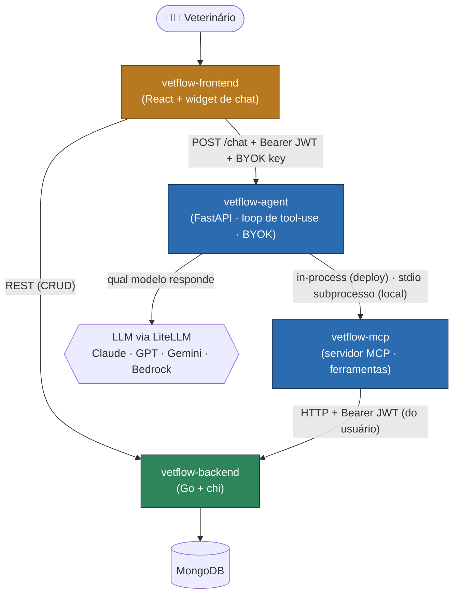
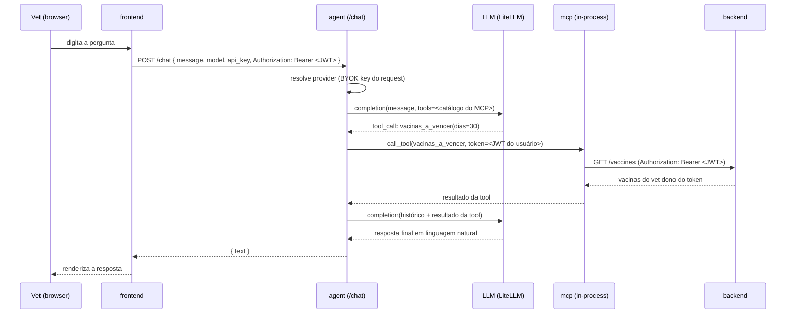

# Arquitetura do VetFlow

Este documento aprofunda o [README](./README.md): ele existe para quem precisa
**entender ou alterar** a arquitetura do assistente de IA, não só usá-lo. O
README dá o mapa; aqui estão as fronteiras, o fluxo ponta-a-ponta, e o **porquê**
de cada decisão não-óbvia.

Escopo: os quatro repositórios (`vetflow-backend`, `vetflow-frontend`,
`vetflow-mcp`, `vetflow-agent`) e como se encaixam. Detalhes internos de cada um
ficam no README do respectivo repo.

---

## 1. Visão de contexto

Quatro componentes independentes, cada um com CI, testes e versionamento
próprios:

| Componente | Stack | Papel | Fala com |
|---|---|---|---|
| `vetflow-backend` | Go, chi, MongoDB | Fonte de verdade dos dados; REST + regras de negócio; JWT + multi-tenant por vet | MongoDB |
| `vetflow-frontend` | React 19, Vite, MUI 7, React Query | SPA de gestão + widget de chat (BYOK) | backend (CRUD), agent (chat) |
| `vetflow-mcp` | Python, SDK MCP, httpx | Expõe o backend como **ferramentas** MCP para qualquer LLM | backend (HTTP + Bearer JWT) |
| `vetflow-agent` | Python, FastAPI, LiteLLM | **Agente** multi-provider; roda o loop de tool-use sobre as tools do MCP | LLM (LiteLLM), mcp |

A regra que organiza tudo: **a IA nunca toca o banco diretamente**. O backend é a
única fonte de verdade sobre o Mongo; o MCP só fala a API HTTP do backend (a
mesma que o frontend usa); o agente só fala o MCP e o LLM. Cada seta é uma
fronteira com um contrato.

---

## 2. O caminho de uma pergunta no chat

O que acontece quando o vet digita *"quais vacinas vencem esse mês?"* no widget:

Pontos-chave do fluxo:

- **O JWT é do usuário logado** (pass-through), não de uma conta de serviço — ver
  decisão em §3.4. O chat age **como o vet logado**: só vê os dados dele.
- **A chave de LLM vem no request** (BYOK) e é usada só nessa chamada — ver §3.3.
- **O loop de tool-use** repete `completion → tool_call → resultado` até o modelo
  parar de pedir ferramentas (teto `MAX_TURNS = 12`).

---

## 3. Decisões de arquitetura

### 3.1 Por que o MCP é um repositório separado

O agente é o principal consumidor do MCP, então é tentador fundir os dois (ambos
Python). **Não se funde** porque o MCP é um *servidor* e o agente é apenas *um
cliente* entre vários: Claude Desktop e outros clientes MCP usam o `vetflow-mcp`
**sem o agente existir**. Fundir mataria a reutilização que é a razão de ser do
MCP — cada cliente teria que reimplementar o acoplamento com o backend.

O agente **consome** o MCP sem fundir código: em dev via `pip install -e
../vetflow-mcp`; no deploy via git **submodule** (`vendor/vetflow-mcp`), que
mantém o build do agente autocontido sem transformar o MCP num detalhe interno.

### 3.2 Por que MCP e não chamar o backend REST direto

Um agente poderia chamar o REST do backend diretamente. O ganho de expor as tools
via **MCP** (padrão aberto) é a **reutilização**: a lógica de "traduzir intenção
em linguagem natural numa chamada autenticada ao backend" mora num só lugar e
serve a todo cliente MCP. As descrições das tools (docstrings PT-BR) são o que
cada LLM lê para decidir *quando* e *como* usá-las.

### 3.3 Multi-provider via LiteLLM + BYOK

O agente roda sobre **qualquer LLM** suportado pelo LiteLLM (Claude, GPT, Gemini,
Bedrock), no formato de function-calling da OpenAI. O provider é escolhido por:

- **explícito** (`LLM_MODEL`), ou **auto-detecção** pela credencial presente
  (ordem: Anthropic → OpenAI → Gemini → Bedrock `.aws`) — caminhos de execução
  **local**;
- **BYOK (bring your own key)** — o frontend manda `model`/`api_key` no `POST
  /chat`; a chave vive **só no navegador** do usuário, é usada só naquela chamada
  e **nunca é persistida nem logada** pelo servidor.

No **deploy, BYOK é o único caminho**: o servidor não carrega nenhuma chave de
LLM (`/health` → `provider_available: false`, que é o estado correto). Assim o
deploy não tem custo de LLM nem se torna guardião de credenciais de terceiros.

### 3.4 Autenticação pass-through (o chat age como o usuário logado)

O frontend envia o **JWT do usuário logado** no header `Authorization` do `POST
/chat`; o agente o repassa ao MCP, que o injeta nas chamadas ao backend. O
backend escopa todos os dados ao vet dono do token. Resultado: **o chat vê
exatamente o que o usuário logado veria** — nada de uma conta de serviço com
visão ampla.

Login por email/senha ainda existe no MCP como **fallback opcional**, para
clientes sem usuário logado (ex.: Claude Desktop). No agente deployado ele não é
usado.

### 3.5 Consumo do MCP: in-process (produção) vs. subprocesso (local)

Esta é a decisão com maior impacto no **perfil de memória** em produção. O
`mcp_bridge.py` do agente suporta dois modos, por `VETFLOW_MCP_INPROCESS`:

| | **In-process** (produção) | **Subprocesso stdio** (default local / Claude Desktop) |
|---|---|---|
| Como roda | o agente importa `vetflow_mcp` e chama as tools direto | o MCP é um processo separado falado por stdio |
| Memória | um só interpretador Python | **dois** coexistem numa chamada (o 2º ~80MB) |
| Isolamento multi-tenant | por `contextvars` (`use_request_client`): client/token por request | por processo: estado não é compartilhado |

**Por que in-process em produção:** no free tier do Render (512MB), os dois
interpretadores coexistindo causavam **OOM-kill** (502 com
`x-render-routing: no-deploy`). O in-process elimina o segundo processo e
estabilizou o serviço. O risco — o `_client` singleton global do MCP vazar token
entre usuários — é fechado mantendo client/token **por request** via
`contextvars`, preservando o isolamento sem subir um processo.

**O subprocesso permanece** como default local e é como o MCP serve o Claude
Desktop; dá isolamento por processo "de graça" para quem roda na própria máquina.

---

## 4. Segurança e multi-tenancy

- **Fonte de verdade única:** só o backend fala com o Mongo; MCP e agente passam
  sempre pela API HTTP autenticada.
- **Escopo por vet:** o backend deriva `vet_id` do JWT; cada tool de leitura e
  escrita só enxerga/afeta os dados do vet dono do token.
- **Credenciais não trafegam para o front como estado do servidor:** a chave de
  LLM é BYOK (navegador); o JWT é do próprio usuário.
- **Escrita é opt-in:** as tools de escrita do MCP só são registradas com
  `VETFLOW_ENABLE_WRITES=true`; **DELETE não é exposto** (destrutivo e
  irreversível, deixado de fora de propósito). O backend seta `vet_id`/
  `created_at` a partir do token — as tools enviam só campos de negócio.

---

## 5. Deploy (produção)

| Componente | Onde | Observações |
|---|---|---|
| frontend | Vercel | `VITE_AGENT_API_URL` aponta para o agente no Render |
| agent | Render (free, 512MB) | `render.yaml`; `VETFLOW_MCP_INPROCESS=true`; BYOK-only; MCP via submodule |
| backend | Render | API Go + MongoDB (Atlas) |

O `render.yaml` do agente é a fonte de verdade do deploy: build
(`pip install . && pip install ./vendor/vetflow-mcp`), start
(`uvicorn vetflow_agent.api.api:app`), e as env vars pass-through/BYOK/in-process
documentadas em comentários.

---

## 6. Limitações conhecidas e evolução

- **RAM no free tier:** mesmo com in-process, a margem de 512MB é apertada; subir
  o plano do Render é a saída se o pico voltar a morder.
- **Escrita conservadora:** sem DELETE e com writes opt-in — por design. Expandir
  exige decisão explícita.
- **Payload nas write-tools do MCP:** candidato de refactor deixado de fora de
  propósito — mudá-lo pioraria a interface que o LLM lê.
- **Validação end-to-end:** o fluxo foi exercitado contra o backend real com
  Bedrock e Gemini; o caminho ponta-a-ponta com JWT pass-through pelo front
  logado é o que fecha a verificação de produção.

---

> Para detalhes internos de cada componente, ver o README do repositório
> correspondente. Este documento cobre apenas o que atravessa as fronteiras.
