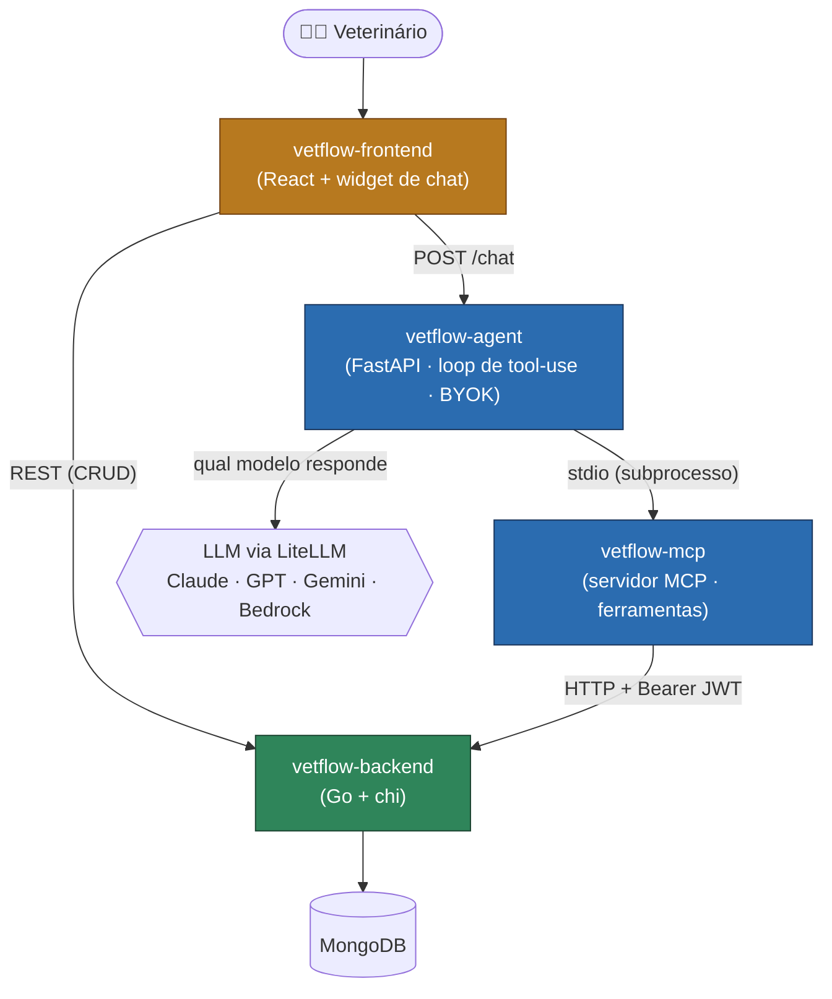

# 🐾 VetFlow

**VetFlow** é um sistema de gestão para clínicas veterinárias, com um
**assistente de IA** integrado que responde perguntas em linguagem natural sobre
os dados reais da clínica. Este repositório é o **mapa** do projeto: a visão
geral e os links para cada componente.

> Projeto de portfólio de [Iann Carvalho](https://github.com/IannCarvalho).

## Visão geral

Um veterinário gerencia clientes, pets, consultas, vacinas, agenda e finanças
pela interface web. Além do CRUD tradicional, há um **assistente de IA** (chat):
o usuário pergunta *"quais vacinas vencem esse mês?"* ou *"quantos pets a Maria
tem?"* e a IA consulta os dados reais antes de responder — sem inventar.

O diferencial técnico é a arquitetura do assistente: um **agente multi-provider**
(Claude, GPT, Gemini ou Amazon Bedrock) que usa um **servidor MCP** como ponte
para as ferramentas que leem o sistema. Cada peça é um projeto independente, com
CI e testes próprios.

## Arquitetura

A IA nunca fala com o banco direto: o **agente** decide *qual modelo* responde,
o **MCP** fornece as *ferramentas* que leem/escrevem via a API do **backend**, e
o backend é a única fonte de verdade sobre o Mongo.

## Componentes

| Repositório | Stack | Papel |
|---|---|---|
| [`vetflow-backend`](https://github.com/IannCarvalho/vetflow-backend) | Go, chi, MongoDB | API REST + regras de negócio. Fonte de verdade dos dados. Auth JWT, multi-tenant por vet. |
| [`vetflow-frontend`](https://github.com/IannCarvalho/vetflow-frontend) | React 19, TypeScript, Vite, MUI 7, React Query | SPA de gestão da clínica + **widget de chat IA** (BYOK) presente em todas as telas. |
| [`vetflow-mcp`](https://github.com/IannCarvalho/vetflow-mcp) | Python, SDK MCP, httpx | Servidor **MCP** que expõe o backend como ferramentas para LLMs (10 de leitura + escrita opt-in). |
| [`vetflow-agent`](https://github.com/IannCarvalho/vetflow-agent) | Python, FastAPI, LiteLLM | Agente **multi-provider** que roda o loop de tool-use sobre as ferramentas do MCP. API HTTP + UI Streamlit. |

## Destaques técnicos

- **Multi-provider via LiteLLM** — o mesmo agente roda sobre Claude, GPT, Gemini
  ou Bedrock; o provider é escolhido por config ou auto-detecção.
- **BYOK (bring your own key)** — o usuário pode usar a própria chave de LLM,
  guardada **só no navegador** (localStorage), nunca no backend. O sistema não
  se torna guardião de credenciais de terceiros.
- **MCP como fronteira limpa** — a IA acessa o produto pela mesma API HTTP que o
  frontend usa, não pelo banco. O MCP é um processo separado, aditivo e seguro.
- **Segurança por padrão** — tools de escrita do MCP são opt-in; DELETE não é
  exposto; credenciais nunca trafegam para o front; cada repo tem CI próprio.

## Rodando o sistema localmente

A ordem importa (cada camada depende da anterior):

1. **MongoDB** — ex.: `docker run -d --rm -p 27017:27017 mongo:7`.
2. **vetflow-backend** — configure `.env` (Mongo, JWT) e rode (`go run ./cmd`).
   Em modo development, um seed cria dados demo.
3. **vetflow-agent** — `pip install -r requirements.txt && pip install -e
   ../vetflow-mcp`; configure `.env` (provider de LLM + `VETFLOW_*`); rode a API:
   `uvicorn api:app --port 8700`.
4. **vetflow-frontend** — `npm install`; `.env` com `VITE_API_BASE_URL` e
   `VITE_AGENT_API_URL`; `npm run dev` (abre em `http://localhost:3039`).

Cada repositório tem instruções detalhadas no seu próprio README.

## Status

Todos os componentes têm CI (lint + testes). O assistente de IA foi validado
end-to-end contra o backend real, usando Amazon Bedrock e Google Gemini.
