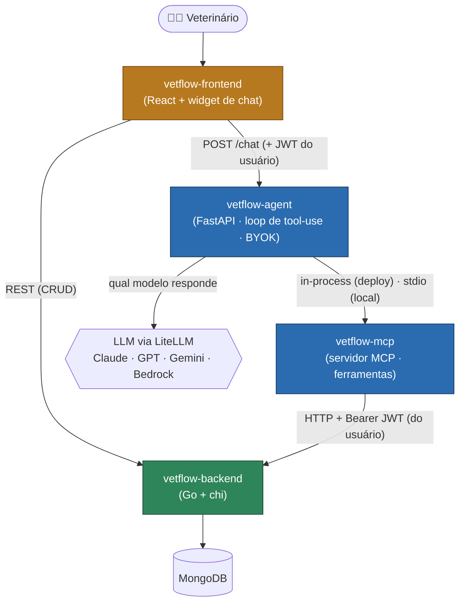

# 🐾 VetFlow

**VetFlow** é um sistema de gestão para clínicas veterinárias, com um
**assistente de IA** integrado que responde perguntas em linguagem natural sobre
os dados reais da clínica. Este repositório é o **mapa** do projeto: a visão
geral e os links para cada componente.

> Projeto de portfólio de [Iann Carvalho](https://github.com/IannCarvalho).

## Demo ao vivo

**[vetflow-frontend-demo.vercel.app](https://vetflow-frontend-demo.vercel.app)** — clique em
**"Entrar como visitante"** para explorar o sistema com uma conta de demonstração, sem
cadastro.

A demo roda num ambiente **isolado** da produção: backend com `APP_ENV=demo` e banco
próprio (`vetflow_demo`) com dados **fictícios**, re-semeado automaticamente no boot
quando o último seed passa da janela configurada (ver
[ARCHITECTURE.md §5](./ARCHITECTURE.md#5-deploy-produção)).

## Visão geral

Um veterinário gerencia clientes, pets, consultas, vacinas, agenda e finanças
pela interface web. Além do CRUD tradicional, há um **assistente de IA** (chat):
o usuário pergunta *"quais vacinas vencem esse mês?"* ou *"quantos pets a Maria
tem?"* e a IA consulta os dados reais antes de responder — sem inventar.

O diferencial técnico é a arquitetura do assistente: um **agente multi-provider**
(Claude, GPT, Gemini ou Amazon Bedrock) que usa um **servidor MCP** como ponte
para as ferramentas que leem o sistema. Cada peça é um projeto independente, com
CI e testes próprios.

## Arquitetura



A IA nunca fala com o banco direto: o **agente** decide *qual modelo* responde,
o **MCP** fornece as *ferramentas* que leem/escrevem via a API do **backend**, e
o backend é a única fonte de verdade sobre o Mongo.

> Para o fluxo ponta-a-ponta de uma pergunta, as decisões de arquitetura (por que
> MCP separado, BYOK, pass-through, in-process vs. subprocesso) e o modelo de
> segurança, ver [**ARCHITECTURE.md**](./ARCHITECTURE.md).

## Componentes

| Repositório | Stack | Papel |
|---|---|---|
| [`vetflow-backend`](https://github.com/IannCarvalho/vetflow-backend) | Go, chi, MongoDB | API REST + regras de negócio. Fonte de verdade dos dados. Auth JWT, multi-tenant por vet. |
| [`vetflow-frontend`](https://github.com/IannCarvalho/vetflow-frontend) | React 19, TypeScript, Vite, MUI 7, React Query | SPA de gestão da clínica + **widget de chat IA** (BYOK) presente em todas as telas. |
| [`vetflow-mcp`](https://github.com/IannCarvalho/vetflow-mcp) | Python, SDK MCP, httpx | Servidor **MCP** que expõe o backend como ferramentas para LLMs (10 de leitura + escrita opt-in). |
| [`vetflow-agent`](https://github.com/IannCarvalho/vetflow-agent) | Python, FastAPI, LiteLLM | Agente **multi-provider** que roda o loop de tool-use sobre as ferramentas do MCP. API HTTP + UI Streamlit. |

## Destaques técnicos

- **Multi-provider via LiteLLM** — o mesmo agente roda sobre Claude, GPT, Gemini
  ou Bedrock; o provider é escolhido por config ou auto-detecção. O LiteLLM lê
  variáveis de ambiente **no momento do `import`**, então no
  [`vetflow-agent`](https://github.com/IannCarvalho/vetflow-agent) o
  `import litellm` vem **logo após o `load_dotenv()`** (para enxergar o `.env`) e
  **no topo do módulo**, nunca dentro de um handler async (um import de ~7s numa
  coroutine, com 1 worker, bloqueia o event loop e derruba o health check). O
  porquê detalhado está no README do agent.
- **BYOK (bring your own key)** — o usuário pode usar a própria chave de LLM,
  guardada **só no navegador** (localStorage), nunca no backend. O sistema não
  se torna guardião de credenciais de terceiros.
- **MCP como fronteira limpa** — a IA acessa o produto pela mesma API HTTP que o
  frontend usa, não pelo banco. Em produção o agente consome o MCP **in-process**
  (um só processo Python, isolamento por-request via `contextvars`); local e no
  Claude Desktop ele roda como subprocesso stdio.
- **Auth pass-through** — o chat age como o **usuário logado**: o JWT dele é
  repassado do front até o backend, que escopa os dados ao vet dono do token.
- **Segurança por padrão** — tools de escrita do MCP são opt-in; DELETE não é
  exposto; credenciais nunca trafegam para o front; cada repo tem CI próprio.

## Clonar tudo

Os quatro componentes são **repositórios independentes** (cada um com CI, testes
e versionamento próprios — ver [ARCHITECTURE.md](./ARCHITECTURE.md)). Este repo é
o mapa, não um monorepo: ele **não** os contém como submodules, de propósito. Para
trabalhar no sistema inteiro, clone os quatro **lado a lado** numa pasta comum —
é o layout que o setup local assume (o `vetflow-agent` referencia
`../vetflow-mcp`):

```bash
mkdir vetflow && cd vetflow
# o agente consome o mcp como submodule no deploy, então use --recursive nele:
git clone --recursive https://github.com/IannCarvalho/vetflow-agent.git
git clone https://github.com/IannCarvalho/vetflow-mcp.git
git clone https://github.com/IannCarvalho/vetflow-frontend.git
git clone https://github.com/IannCarvalho/vetflow-backend.git
```

> Só o `vetflow-agent` precisa de `--recursive`: ele embute o `vetflow-mcp` como
> git submodule (`vendor/vetflow-mcp`) para que o deploy seja autocontido. Os
> outros três são clones simples.

## Rodando o sistema localmente

A ordem importa (cada camada depende da anterior):

1. **MongoDB** — ex.: `docker run -d --rm -p 27017:27017 mongo:7`.
2. **vetflow-backend** — configure `.env` (Mongo, JWT) e rode (`go run ./cmd`).
   Em modo development, um seed cria dados demo. Use um banco próprio
   (ex.: `MONGO_DB=vetflow_dev`): fora de produção o backend **recusa subir**
   apontando para o banco de produção `vetflow`.
3. **vetflow-agent** — `pip install -e . && pip install -e ../vetflow-mcp`;
   configure `.env` (provider de LLM + `VETFLOW_*`); rode a API:
   `uvicorn vetflow_agent.api.api:app --port 8700` (a porta que o frontend usa por
   padrão).
4. **vetflow-frontend** — `npm install`; `.env` com
   `VITE_API_BASE_URL=http://localhost:8080` e
   `VITE_AGENT_API_URL=http://localhost:8700`; `npm run dev` (abre em
   `http://localhost:3039`).

Cada repositório tem instruções detalhadas no seu próprio README.

## Status

Cada componente tem CI próprio com testes; o frontend roda também um gate de
acessibilidade (axe-core, WCAG 2.1 AA) sobre as telas principais. O assistente de IA foi
validado end-to-end contra o backend real, usando Amazon Bedrock e Google Gemini.
